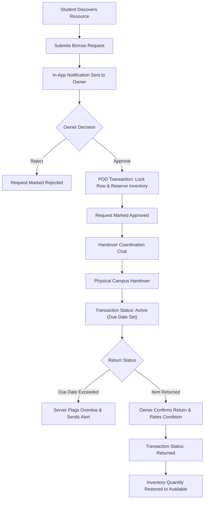

# Campus Resource Sharing Platform - Architecture Documentation

## 1. System Overview
The **Campus Resource Sharing Platform** is a full-stack, modular web application engineered using **Core PHP 8.2**, **MySQL / MariaDB**, **HTML5**, **CSS3**, and **Vanilla JavaScript** styled with **Bootstrap 5**. It operates as a circular academic utility for colleges and universities, allowing students and faculty to share, borrow, exchange, and donate educational resources.

---

## 2. Architectural Layers

### A. Presentation Layer (Frontend)
- **Responsive Layout**: Bootstrap 5.3 grid system and custom CSS with a clean, light-themed glassmorphism aesthetic.
- **Client Interactions**: Vanilla JavaScript (`assets/js/main.js`) handling real-time form validation, modal state transitions, confirm dialogs on destructive actions, image upload previews, and chat auto-scroll.
- **Visual Feedback**: Semantic color badges for conditions, sharing methods, and statuses (Pending, Approved, Active, Overdue, Returned). Neutral category SVG vector graphics are rendered when a resource lacks a photograph.

### B. Controller & Application Routing Layer
- Structured page controllers organized into distinct functional domains:
  - **Public / Auth**: `index.php`, `login.php`, `register.php`, `logout.php`
  - **Student Portal**: `student/dashboard.php`, `student/browse_resources.php`, `student/resource_details.php`, `student/add_resource.php`, `student/edit_resource.php`, `student/my_resources.php`, `student/lending_requests.php`, `student/my_requests.php`, `student/borrowed_items.php`, `student/lent_items.php`, `student/donations.php`, `student/exchanges.php`, `student/notifications.php`, `student/messages.php`, `student/profile.php`
  - **Faculty Portal**: `faculty/dashboard.php`, `faculty/resources.php`, `faculty/requests.php`, `faculty/announcements.php`
  - **Admin Console**: `admin/dashboard.php`, `admin/users.php`, `admin/resources.php`, `admin/categories.php`, `admin/transactions.php`, `admin/reports.php`, `admin/settings.php`, `admin/audit_logs.php`, `admin/announcements.php`
  - **REST API Endpoints**: `api/resources/`, `api/notifications/`, `api/analytics/`

### C. Business Logic / Service Layer
Dedicated service classes encapsulating institutional rules and data integrity:
- `ResourceService`: Catalog CRUD, multi-criteria filtering, pagination, and inventory availability synchronization.
- `RequestService`: Borrowing lifecycle, inventory locks, duplicate request prevention, and concurrency protection.
- `TransactionService`: Handover confirmation, due date calculations, overdue status enforcement, and return condition inspections.
- `DonationService`: Permanent transfer workflow and recipient handover.
- `ExchangeService`: Barter proposals, terms matching, mutual approval, and trade completion.
- `NotificationService`: In-app notification creation, unread indicators, and read receipts.
- `MessageService`: One-on-one coordination chat linked to resource requests.
- `AnalyticsService`: Database metrics and formula-injection-safe CSV export generation.

### D. Data Persistence Layer (MySQL)
- Direct PDO database interaction with UTF-8 character encoding (`utf8mb4`).
- Strict use of prepared statements with parameter binding to prevent SQL injection.
- Atomic ACID transactions (`$pdo->beginTransaction()`, `$pdo->commit()`, `$pdo->rollBack()`) protecting inventory levels from race conditions.
- Foreign key constraints with cascading or restrict rules to preserve institutional audit trails.

---

## 3. Request Lifecycle Diagram

---

## 4. Security Architecture

| Security Mechanism | Implementation Details |
| :--- | :--- |
| **Password Security** | Bcrypt cryptographic hashing via PHP's native `password_hash()` and `password_verify()`. Plaintext passwords are never stored. |
| **Session Security** | Session ID regeneration (`session_regenerate_id(true)`) upon authentication. Cookies configured with `HttpOnly`, `SameSite=Lax`, and optional `Secure` flags. |
| **CSRF Defense** | Cryptographically secure 64-character tokens generated via `random_bytes(32)`. Verified using timing-attack-safe `hash_equals()`. |
| **SQL Injection** | Exclusively parameterized PDO prepared statements across all queries. |
| **XSS Defense** | Centralized escaping utility `e($string)` applying `htmlspecialchars($str, ENT_QUOTES, 'UTF-8')`. |
| **File Upload Safety** | MIME type inspection via `finfo` (allowing only JPEG, PNG, WebP), file size limits (5MB), randomized storage filenames, and `.htaccess` script execution prevention in `uploads/`. |
| **Access Control (RBAC)** | Strict server-side route guards: `require_auth()` and `require_role(['admin', 'faculty', 'student'])`. Ordinary users receive HTTP 403 Forbidden when attempting to access unauthorized endpoints. |
| **CSV Formula Injection** | Prepends single quotes to values starting with `=`, `+`, `-`, `@`, `\t`, or `\r` during CSV export. |
| **Audit Logging** | Sensitive events (logins, logouts, moderation actions, takedowns, policy changes) recorded in `audit_logs` with timestamps and IP addresses. |
