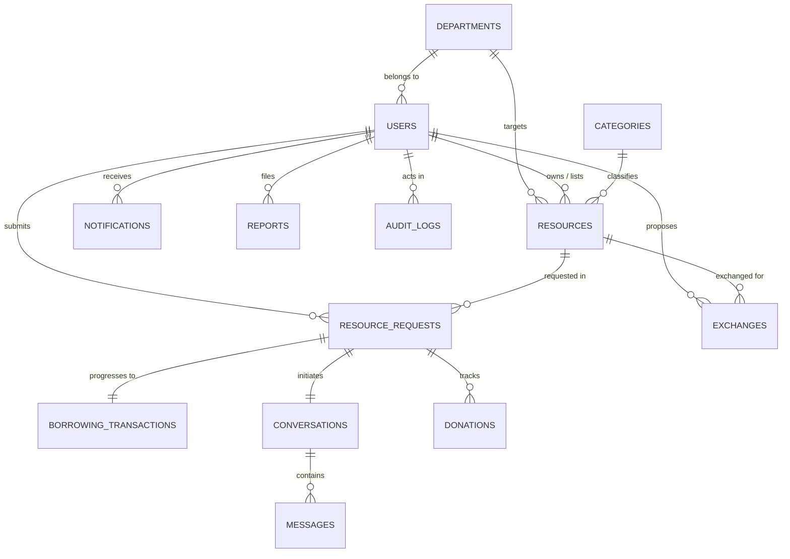

# Campus Resource Sharing Platform - Database Design

## 1. Database Specifications
- **Database Name**: `campus_resource_sharing`
- **Database Engine**: MySQL 5.7+ / MariaDB 10.3+
- **Default Storage Engine**: InnoDB (ACID Compliant)
- **Character Set**: `utf8mb4`
- **Collation**: `utf8mb4_unicode_ci`

---

## 2. Entity-Relationship Model

---

## 3. Schema Data Dictionary

### 1. `departments`
Stores academic divisions participating in resource sharing.
- `id` (INT, PK, AUTO_INCREMENT)
- `department_name` (VARCHAR(100), NOT NULL)
- `department_code` (VARCHAR(20), NOT NULL, UNIQUE)
- `status` (ENUM('active', 'inactive'), DEFAULT 'active')
- `created_at` (TIMESTAMP)

### 2. `users`
Accounts for students, faculty, and administrators.
- `id` (INT, PK, AUTO_INCREMENT)
- `full_name` (VARCHAR(100), NOT NULL)
- `email` (VARCHAR(150), NOT NULL, UNIQUE)
- `password_hash` (VARCHAR(255), NOT NULL)
- `institution_id` (VARCHAR(50), NOT NULL, UNIQUE)
- `department_id` (INT, FK -> departments.id, NULL)
- `role` (ENUM('student', 'faculty', 'admin'), DEFAULT 'student')
- `course` (VARCHAR(100), NULL)
- `semester` (INT, NULL)
- `designation` (VARCHAR(100), NULL)
- `phone` (VARCHAR(30), NULL)
- `profile_image` (VARCHAR(255), NULL)
- `account_status` (ENUM('active', 'suspended', 'pending'), DEFAULT 'active')
- `created_at`, `updated_at` (TIMESTAMP)

### 3. `categories`
Resource classifications.
- `id` (INT, PK, AUTO_INCREMENT)
- `category_name` (VARCHAR(100), NOT NULL, UNIQUE)
- `slug` (VARCHAR(100), NOT NULL, UNIQUE)
- `description` (TEXT, NULL)
- `icon_class` (VARCHAR(50), DEFAULT 'bi-box-seam')
- `status` (ENUM('active', 'inactive'), DEFAULT 'active')
- `created_at` (TIMESTAMP)

### 4. `resources`
Physical and educational materials listed for campus sharing.
- `id` (INT, PK, AUTO_INCREMENT)
- `owner_id` (INT, FK -> users.id, ON DELETE CASCADE)
- `category_id` (INT, FK -> categories.id, ON DELETE RESTRICT)
- `department_id` (INT, FK -> departments.id, ON DELETE SET NULL)
- `title` (VARCHAR(200), NOT NULL)
- `description` (TEXT, NOT NULL)
- `resource_type` (ENUM('book', 'notes', 'calculator', 'stationery', 'electronics', 'lab_equipment', 'engineering_tool', 'sports', 'art_supplies', 'hostel_item', 'other'))
- `sharing_method` (ENUM('borrow', 'donate', 'exchange', 'temporary_use'))
- `condition_status` (ENUM('new', 'like_new', 'good', 'fair', 'poor'))
- `total_quantity` (INT, DEFAULT 1)
- `available_quantity` (INT, DEFAULT 1)
- `borrowing_duration_days` (INT, DEFAULT 7)
- `exchange_requirements` (TEXT, NULL)
- `collection_instructions` (TEXT, NULL)
- `usage_instructions` (TEXT, NULL)
- `image_path` (VARCHAR(255), NULL)
- `course_semester_tag` (VARCHAR(100), NULL)
- `availability_status` (ENUM('available', 'reserved', 'borrowed', 'unavailable', 'under_review'))
- `moderation_status` (ENUM('approved', 'pending_approval', 'rejected'))
- `created_at`, `updated_at` (TIMESTAMP)

### 5. `resource_requests`
Formal requests submitted by students to borrow, receive, or exchange an item.
- `id` (INT, PK, AUTO_INCREMENT)
- `resource_id` (INT, FK -> resources.id, ON DELETE RESTRICT)
- `requester_id` (INT, FK -> users.id, ON DELETE CASCADE)
- `request_type` (ENUM('borrow', 'donate', 'exchange', 'temporary_use'))
- `requested_start_date` (DATE)
- `requested_duration_days` (INT, DEFAULT 7)
- `proposed_return_date` (DATE)
- `purpose` (TEXT, NULL)
- `quantity_requested` (INT, DEFAULT 1)
- `status` (ENUM('pending', 'approved', 'rejected', 'cancelled', 'ready_for_collection', 'borrowed', 'return_pending', 'returned', 'overdue', 'disputed'))
- `decision_reason` (TEXT, NULL)
- `alternative_pickup_date` (DATE, NULL)
- `created_at`, `updated_at` (TIMESTAMP)

### 6. `borrowing_transactions`
Physical handover and return tracking.
- `id` (INT, PK, AUTO_INCREMENT)
- `request_id` (INT, FK -> resource_requests.id, UNIQUE, ON DELETE RESTRICT)
- `resource_id` (INT, FK -> resources.id, ON DELETE RESTRICT)
- `owner_id` (INT, FK -> users.id, ON DELETE RESTRICT)
- `borrower_id` (INT, FK -> users.id, ON DELETE RESTRICT)
- `quantity` (INT, DEFAULT 1)
- `handover_at` (DATETIME)
- `due_at` (DATETIME)
- `returned_at` (DATETIME, NULL)
- `transaction_status` (ENUM('active', 'returned', 'overdue', 'damaged', 'lost', 'disputed'))
- `condition_on_return` (VARCHAR(50), NULL)
- `damage_notes` (TEXT, NULL)
- `created_at`, `updated_at` (TIMESTAMP)

### 7. `donations`
Permanent, free transfers of equipment and textbooks.
- `id` (INT, PK, AUTO_INCREMENT)
- `resource_id` (INT, FK -> resources.id)
- `donor_id` (INT, FK -> users.id)
- `recipient_id` (INT, FK -> users.id)
- `request_id` (INT, FK -> resource_requests.id, UNIQUE)
- `handover_at` (DATETIME, NULL)
- `completion_at` (DATETIME, NULL)
- `status` (ENUM('pending', 'handover_scheduled', 'completed', 'cancelled'))
- `notes` (TEXT, NULL)
- `created_at` (TIMESTAMP)

### 8. `exchanges`
Direct item-for-item trades.
- `id` (INT, PK, AUTO_INCREMENT)
- `proposer_id` (INT, FK -> users.id)
- `listing_resource_id` (INT, FK -> resources.id)
- `offered_resource_id` (INT, FK -> resources.id, NULL)
- `offered_item_description` (TEXT)
- `proposed_terms` (TEXT, NULL)
- `status` (ENUM('proposed', 'accepted', 'rejected', 'handover_pending', 'completed', 'cancelled'))
- `agreed_at`, `completed_at` (DATETIME, NULL)
- `created_at`, `updated_at` (TIMESTAMP)

### 9. `conversations` & `messages`
In-app communication linked to resource requests.
- `conversations`: `id`, `resource_request_id` (UNIQUE, FK), `created_at`, `updated_at`
- `messages`: `id`, `conversation_id` (FK), `sender_id` (FK), `message_body`, `read_at`, `created_at`

### 10. `notifications`
In-app user notification store.
- `id` (INT, PK, AUTO_INCREMENT)
- `user_id` (INT, FK -> users.id)
- `title` (VARCHAR(150))
- `message` (TEXT)
- `notification_type` (VARCHAR(50))
- `related_resource_id` (INT, NULL)
- `related_request_id` (INT, NULL)
- `read_at` (DATETIME, NULL)
- `created_at` (TIMESTAMP)

### 11. `reports`, `announcements`, `settings`, `audit_logs`
- `reports`: Tracks flagged listings (`reporter_id`, `resource_id`, `report_reason`, `status`, `resolved_by`).
- `announcements`: Campus bulletin notices (`title`, `content`, `audience`, `status`).
- `settings`: System configurations (`setting_key`, `setting_value`).
- `audit_logs`: Immutable security log (`actor_id`, `action`, `entity_type`, `entity_id`, `ip_address`).

---

## 4. Referential Integrity & Deletion Rules
- **Cascade Deletions**: Deleting a user cascades to their profile image and notifications.
- **Restrict Deletions**: Resources referenced by historical or active borrowing transactions cannot be hard-deleted. The application safely marks them as `unavailable` to prevent orphan records and maintain institutional accountability.
- **Set Null**: Deleting a department sets `users.department_id` and `resources.department_id` to NULL without breaking user accounts or listings.
